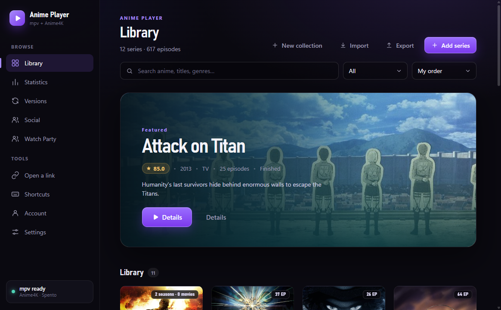
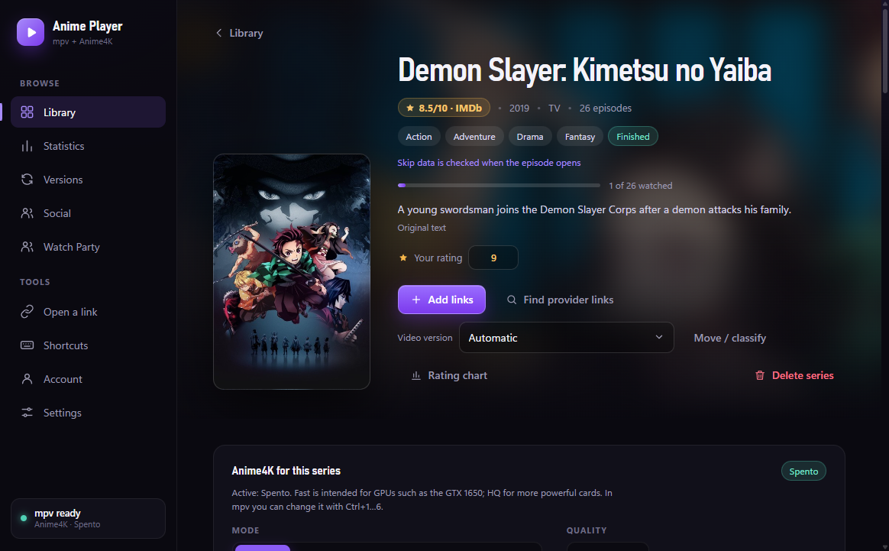
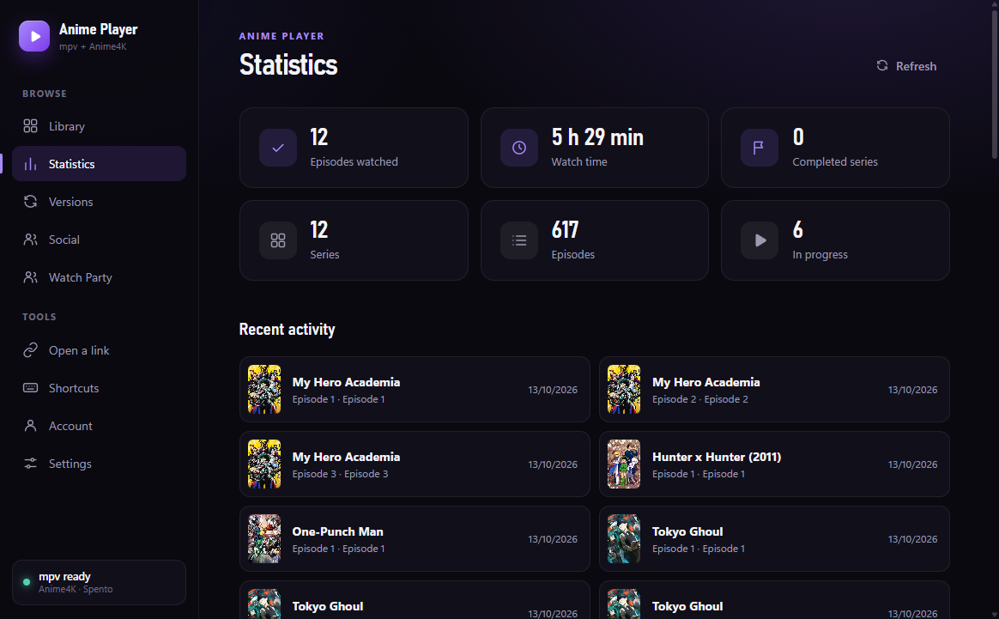

# Anime Player

[Download the latest release](https://github.com/Adrotto2008/anime-player/releases/latest) · [Full changelog](CHANGELOG.md)

Anime Player is a desktop library and playback companion for anime. It organizes titles, episode links, metadata, and watch progress, then opens video in the external **mpv** player with **Anime4K** shaders. Anime Player does not host or download video files.

## Screenshots

These screenshots use an isolated demo library. The library and watch progress are synthetic; no personal account or library data is shown.

<p align="center">
  <a href="docs/screenshots/library.png"></a>
</p>
<p align="center">
  <a href="docs/screenshots/series-details.png"></a>
  <a href="docs/screenshots/statistics.png"></a>
</p>

## Why use Anime Player?

- Keep your anime collection, episode links, and viewing progress together in one library.
- Find provider links automatically, while keeping manual links available for editing and fallback.
- Watch through mpv and its Anime4K shaders instead of storing video files in the app.
- Use the local library offline, with optional private account sync and Watch Party features when you want them.
- Join friends for synchronized playback while each device resolves its own source.

## Features

- **Library and metadata:** search AniList, add titles manually, browse posters and descriptions, and group related seasons while keeping each work's progress and sources independent.
- **Episode information and ratings:** episode titles and thumbnails from Kitsu, AniList metadata, IMDb series and episode ratings when available, and a visual rating chart.
- **Source discovery and playback:** AnimeUnity is searched first, then AnimeWorld. Strict title and episode checks reduce mismatches. Direct video links, HLS playlists, local files, and supported yt-dlp pages can be opened in mpv; saved manual links remain available as fallbacks.
- **Progress and organization:** resume playback, autoplay the next episode, track watched episodes and time, organize library cards and collections, and set manual opening or ending skips.
- **Anime4K:** bundled v4.0.1 shaders with selectable presets for the whole app, individual series, or active playback.
- **Watch Party:** create public rooms or private rooms with approval and friend invitations. Hosts can share playback controls, manage participants, and recover after disconnects. Every client resolves its own source; video files, source URLs, and credentials are not sent to the room.
- **Social and private sync:** optional profiles, friend requests, and a private library snapshot synced to the signed-in account. Automatic provider stream URLs stay on the device.
- **Statistics and preferences:** view watch history, totals, and per-series progress; choose English or Italian, themes, audio/subtitle preferences, and mpv shortcuts.

## Download and install

The current version is **v0.5.57**. Open the [latest release page](https://github.com/Adrotto2008/anime-player/releases/latest) and download the package for your operating system:

- **Windows x64:** `AnimePlayer-Setup-0.5.57.exe` installs the app; `AnimePlayer-portable.exe` runs without an installer.
- **Linux x86_64:** use `AnimePlayer-0.5.57-x86_64.AppImage` or `AnimePlayer-0.5.57-amd64.deb`.
- **macOS Intel and Apple Silicon:** use `AnimePlayer-0.5.57-universal.dmg` or the universal ZIP. Open the DMG and drag Anime Player into Applications. This package is ad-hoc signed and is not notarized by Apple; if macOS blocks the first launch, use System Settings → Privacy & Security → Open Anyway.

On Windows, run the installer or portable executable. On Linux, make the AppImage executable before launching it, or install the DEB package with your system's package installer. The installed app does not require Node.js.

**mpv is required for playback.** Anime Player includes Anime4K shaders and offers first-run setup to find or configure mpv. Supported Windows builds can help install the official mpv release; other platforms can follow the [mpv installation guide](https://mpv.io/installation/) and select the executable in Settings. You can browse the library without configuring mpv, but playback needs it.

Version 0.5.57 shortens the macOS mpv control socket path to prevent IPC connection timeouts on systems with long temporary-directory paths.

## Quick start

1. Open **Add series** and search AniList, or add a title manually.
2. Let Anime Player search for episode links in the background. If a result is missing or does not match, retry discovery or add your own link.
3. Open an episode and choose **Watch** or **Resume**. Anime Player launches mpv and saves viewing progress.
4. Use **Statistics** to review watch time and recent activity. Adjust language, theme, playback, or mpv settings from **Settings**.
5. Sign in only if you want account features such as private sync, Social, or Watch Party. Each Watch Party participant needs a usable source for the episode on their own device.

## Local data and privacy

The library works locally and remains available offline. When you sign in, Anime Player can sync a private, account-owned library snapshot, including manual links and custom headers. Automatic provider stream URLs are kept on the device and rediscovered as needed.

Watch Party synchronizes playback state and controls; it does not send video files, source URLs, or credentials. Anime Player does not host video files or download episodes.

## Build from source

Source checkout and package builds require **Node.js 22.12.0 or newer**. Install dependencies and start the app with:

```bash
npm ci
npm start
```

To check the project or build a package for the current operating system:

```bash
npm run check
npm run dist
```

Builds produce Windows portable and NSIS packages, macOS DMG/ZIP packages, or Linux AppImage/DEB packages on their respective platforms. The source checkout uses a disposable local profile; it does not use the installed app's library.

## Latest updates

Only the two latest release summaries are kept here. The full history is in [CHANGELOG.md](CHANGELOG.md).

### v0.5.57 — macOS playback control and packages

Shorter mpv control socket paths avoid IPC connection timeouts on macOS. Universal DMG and ZIP packages support Intel and Apple Silicon Macs; no Node.js or npm is needed to launch the installed app.

### v0.5.56 — Watch Party resynchronization shortcuts

Use `Ctrl+Alt+R` to resynchronize your own player and `Ctrl+Alt+Shift+R` to resynchronize everyone as the host. Both shortcuts are configurable in the Shortcuts page and work in mpv fullscreen. The host also has a Resync everyone button. Explicit resynchronization reattaches individually paused players and corrects their position immediately; ordinary drift correction stays gradual. Followers apply the current room state as soon as their source loads.

## Credits

- [AniList](https://anilist.co/) and [Kitsu](https://kitsu.io/) provide anime and episode metadata; [IMDb](https://www.imdb.com/) provides ratings.
- [Anime4K](https://github.com/bloc97/Anime4K) shaders are included under the MIT license; see `shaders/LICENSE-Anime4K.txt`.
- Episode discovery is an independent JavaScript implementation informed by [AnimeWorld-API](https://github.com/MainKronos/AnimeWorld-API) and [AnimeUnityDownloader](https://github.com/Lysagxra/AnimeUnityDownloader). Anime Player does not bundle their Python packages or copy their source code.

Anime Player is released under the [MIT License](LICENSE).
